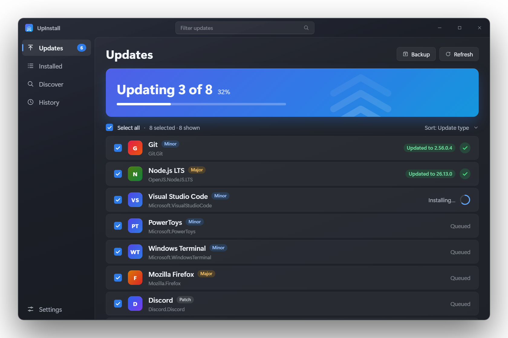

<p align="center">
  
</p>

<h1 align="center">UpInstall</h1>

<p align="center">
  <b>A simple, native Windows UI for <code>winget</code>.</b><br />
  See every app that has an update, tick the ones you want, and install them in one click.<br />
  <sub>Formerly called Updraft. Your settings and history move over automatically on first launch.</sub>
</p>

<p align="center">
  <a href="https://github.com/bilal8492/upinstall/actions/workflows/ci.yml"></a>
  <a href="https://github.com/bilal8492/upinstall/releases/latest"></a>
  <a href="LICENSE"></a>
  
</p>

<p align="center">
  <a href="https://bilalansari.in/upinstall/">Website</a> ·
  <a href="https://github.com/bilal8492/upinstall/releases/latest">Download</a> ·
  <a href="https://github.com/bilal8492/upinstall/issues">Report a bug</a>
</p>

<p align="center">
  
</p>

---

## Why

`winget upgrade` is great, but reading its table and typing package ids by hand isn't. UpInstall is the
Windows counterpart of the "Homebrew GUI" apps on macOS: a small, fast, native front-end that does one job well.

## Features

**Updates**

- **Scans for updates on launch** and shows how many there are, with a major / minor / patch breakdown.
- **Update all in one click**, or tick the apps you want. Filter as you type, by source, or sort by update type.
- **Live progress inside the app:** each app shows a progress ring and its result, and the taskbar button shows
  progress for the whole run (it flashes if the run finishes while UpInstall is in the background).
- **Skip just one version** of an update (it comes back when a newer one ships), skip an app for good, or **pin** it
  with `winget pin`. Skips can be undone right away and managed in Settings.
- **Choose a version:** install or update to a specific release instead of the newest one.

**Apps**

- **Detail pane** with release notes ("What's new"), description, publisher, licence, homepage, installer type and
  tags (from `winget show`), plus the exact `winget` command.
- **Right-click any row** (or hover it) for quick actions: install / update / uninstall now, skip, pin, choose a
  version, copy the id or command, open the homepage.
- **Installed** view to browse and uninstall everything on the machine.
- **Discover** to search the whole winget catalogue, with one-click popular searches.
- **Starter packs** for setting up a new PC: Essentials, Developer, Creative, Chat & meetings, Gaming and
  Privacy & security. Apps you already have are left alone.
- **Backup & restore.** Export your installed apps to a JSON file, then restore them on a new PC: UpInstall shows which
  are already installed and ticks the rest. Uses winget's own export format.

**Running**

- **Generates the script for you.** Copy the exact `winget` commands and paste them into any terminal…
- **…or run them in a terminal.** UpInstall opens Windows Terminal (or PowerShell) with the selection.
- **Optional "Run as administrator"** for apps that need elevation.
- **History** of every install, update and uninstall run inside UpInstall, grouped by day. Stored locally only.

**The app**

- **Native WinUI 3** with a Windows 11 look: Mica backdrop, light, dark or system theme, and motion that follows the
  Windows "Animation effects" setting (or can be turned off in Settings).
- **Keyboard shortcuts:** `Ctrl+1`–`4` switch pages, `F5` rescans, `Ctrl+F` searches, `Ctrl+A` selects all,
  `Ctrl+Enter` starts, `Esc` cancels, `Ctrl+,` opens Settings, `F1` lists them all.
- Remembers its window size and position, and explains how to get winget if it isn't installed.
- Runs on **Windows 10 (1809+) and Windows 11**, on **x64 and ARM64**.
- No telemetry, no accounts, no network calls of its own. It only talks to `winget`.

## Install

Download the installer for your CPU and run it (direct links, always the newest release):

| Your PC | Installer | Portable zip |
| --- | --- | --- |
| Intel / AMD (x64) | [**UpInstall-win-x64-setup.exe**](https://github.com/bilal8492/upinstall/releases/latest/download/UpInstall-win-x64-setup.exe) | [zip](https://github.com/bilal8492/upinstall/releases/latest/download/UpInstall-win-x64.zip) |
| Windows on ARM (Snapdragon X, Surface Pro X…) | [**UpInstall-win-arm64-setup.exe**](https://github.com/bilal8492/upinstall/releases/latest/download/UpInstall-win-arm64-setup.exe) | [zip](https://github.com/bilal8492/upinstall/releases/latest/download/UpInstall-win-arm64.zip) |

All versions are on the [releases page](https://github.com/bilal8492/upinstall/releases).

An **MSIX** package is also built for the Microsoft Store and for sideloading; see [packaging/README.md](packaging/README.md).

The installer needs no admin rights by default (it installs for your user), adds a Start menu entry and an uninstaller.
Prefer portable? Extract the zip anywhere and run `UpInstall.exe`.

**Requirements:** Windows 10 1809 or newer with [winget](https://learn.microsoft.com/windows/package-manager/winget/)
(App Installer) available. Windows 11 includes it. The .NET runtime and Windows App SDK are bundled, so there is nothing else to install.

> **SmartScreen:** the binaries are not code-signed yet, so Windows may show "Windows protected your PC". Click
> *More info → Run anyway*. You can verify downloads with the `SHA256SUMS.txt` attached to each release, or with
> GitHub's build-provenance attestation:
> `gh attestation verify <zip> --repo bilal8492/upinstall`.

## Build from source

Requires the [.NET 9 SDK](https://dotnet.microsoft.com/download) on Windows.

```powershell
git clone https://github.com/bilal8492/upinstall.git
cd upinstall
.\build.cmd            # builds Release for x64
.\Start-UpInstall.cmd  # runs it
```

Run it with `--demo` to try the UI with sample data and simulated installs. Nothing is installed or removed, winget
isn't called, and demo mode keeps its own settings and history (in `%LOCALAPPDATA%\UpInstall\demo`):

```powershell
.\UpInstall\bin\x64\Release\net9.0-windows10.0.19041.0\win-x64\UpInstall.exe --demo
```

Build for ARM64 or publish a self-contained folder:

```powershell
dotnet publish UpInstall/UpInstall.csproj -c Release -p:Platform=ARM64 -r win-arm64 --self-contained true -o publish/win-arm64
```

## How it works

UpInstall shells out to `winget` (`upgrade`, `list`, `search`, `show`) and parses the fixed-width table output. Column
positions come from the header line, so it works regardless of the Windows display language. Installs run inside the
app with winget's output captured per package; "Run in terminal" and admin runs pass a generated PowerShell script to
Windows Terminal or PowerShell instead. Package ids and chosen versions are validated against a strict pattern before
they ever reach a command line.

```
UpInstall/
  MainWindow.xaml(.cs)   layout, loading, filtering, detail pane and the in-app runner
  MainWindow.Chrome.cs   status, toasts, hero card, empty states, context menus
  MainWindow.Pages.cs    Settings, Discover start page, version picker, shortcuts
  WingetService.cs       winget process + output parser
  Pkg.cs, History.cs     data models, local history and backup files
  Catalog.cs             starter packs and popular searches
  Motion.cs, Controls.cs animations and small custom controls
  Styles.xaml            colours, typography and shared styles
  DemoData.cs            sample data for --demo
installer/upinstall.iss  Inno Setup script for the setup .exe
docs/                    the project website (GitHub Pages)
promo-video/             the promo video, made with Remotion (see its README)
.github/workflows/       CI, release and Pages pipelines
```

## Roadmap

- [x] Update everything / ignore (pin) a package
- [x] Live progress inside the app
- [ ] Winget package manifest (`winget install UpInstall`)
- [ ] Code-signed releases
- [ ] Tray icon with update notifications

Ideas and pull requests are welcome. See [CONTRIBUTING.md](CONTRIBUTING.md).

## Disclaimer

UpInstall is an independent open-source project. It is not affiliated with or endorsed by Microsoft. *Windows* and
*winget* are trademarks of Microsoft Corporation.

## License

[MIT](LICENSE) © 2026 Bilal Ansari
