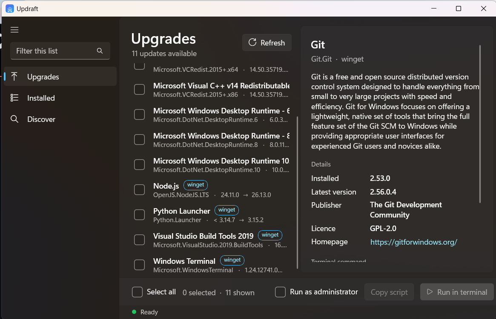

<p align="center">
  
</p>

<h1 align="center">Updraft</h1>

<p align="center">
  <b>A simple, native Windows UI for <code>winget</code>.</b><br />
  See every app that has an update, tick the ones you want, and install them in one click.
</p>

<p align="center">
  <a href="https://github.com/bilal8492/updraft/actions/workflows/ci.yml"></a>
  <a href="https://github.com/bilal8492/updraft/releases/latest"></a>
  <a href="LICENSE"></a>
  
</p>

<p align="center">
  <a href="https://bilal8492.github.io/updraft/">Website</a> ·
  <a href="https://github.com/bilal8492/updraft/releases/latest">Download</a> ·
  <a href="https://github.com/bilal8492/updraft/issues">Report a bug</a>
</p>

<p align="center">
  
</p>

---

## Why

`winget upgrade` is great, but reading its table and typing package ids by hand isn't. Updraft is the
Windows counterpart of the "Homebrew GUI" apps on macOS: a small, fast, native front-end that does one job well.

## Features

- **Scans for updates on launch** and lists every app that has a newer version (installed → available).
- **Pick what you want.** Tick individual apps or *Select all*; filter the list as you type.
- **Generates the script for you.** Copy the exact `winget` commands and paste them into any terminal…
- **…or run them in one click.** Updraft opens Windows Terminal (or PowerShell) and installs the selection.
- **Optional "Run as administrator"** for apps that need elevation.
- **Installed** view to browse everything on the machine, and **Discover** to search the whole winget catalogue.
- **Detail pane** with description, publisher, licence and homepage (from `winget show`).
- **Native WinUI 3** app: Windows 11 look, Mica backdrop, automatic light/dark theme.
- Runs on **Windows 10 (1809+) and Windows 11**, on **x64 and ARM64**.
- No telemetry, no accounts, no network calls of its own. It only talks to `winget`.

## Install

Download the installer for your CPU and run it (direct links, always the newest release):

| Your PC | Installer | Portable zip |
| --- | --- | --- |
| Intel / AMD (x64) | [**Updraft-win-x64-setup.exe**](https://github.com/bilal8492/updraft/releases/latest/download/Updraft-win-x64-setup.exe) | [zip](https://github.com/bilal8492/updraft/releases/latest/download/Updraft-win-x64.zip) |
| Windows on ARM (Snapdragon X, Surface Pro X…) | [**Updraft-win-arm64-setup.exe**](https://github.com/bilal8492/updraft/releases/latest/download/Updraft-win-arm64-setup.exe) | [zip](https://github.com/bilal8492/updraft/releases/latest/download/Updraft-win-arm64.zip) |

All versions are on the [releases page](https://github.com/bilal8492/updraft/releases).

An **MSIX** package is also built for the Microsoft Store and for sideloading; see [packaging/README.md](packaging/README.md).

The installer needs no admin rights by default (it installs for your user), adds a Start menu entry and an uninstaller.
Prefer portable? Extract the zip anywhere and run `Updraft.exe`.

**Requirements:** Windows 10 1809 or newer with [winget](https://learn.microsoft.com/windows/package-manager/winget/)
(App Installer) available. Windows 11 includes it. The .NET runtime and Windows App SDK are bundled, so there is nothing else to install.

> **SmartScreen:** the binaries are not code-signed yet, so Windows may show "Windows protected your PC". Click
> *More info → Run anyway*. You can verify downloads with the `SHA256SUMS.txt` attached to each release, or with
> GitHub's build-provenance attestation:
> `gh attestation verify <zip> --repo bilal8492/updraft`.

## Build from source

Requires the [.NET 9 SDK](https://dotnet.microsoft.com/download) on Windows.

```powershell
git clone https://github.com/bilal8492/updraft.git
cd updraft
.\build.cmd          # builds Release for x64
.\Start-Updraft.cmd  # runs it
```

Build for ARM64 or publish a self-contained folder:

```powershell
dotnet publish Updraft/Updraft.csproj -c Release -p:Platform=ARM64 -r win-arm64 --self-contained true -o publish/win-arm64
```

## How it works

Updraft shells out to `winget` (`upgrade`, `list`, `search`, `show`) and parses the fixed-width table output. Column
positions come from the header line, so it works regardless of the Windows display language. When you run a selection,
it writes a small PowerShell script to `%LOCALAPPDATA%\Updraft\runs\` and opens it in a terminal. Package ids are
validated against a strict pattern before they ever reach that script.

```
Updraft/
  MainWindow.xaml(.cs)   UI and interaction
  WingetService.cs       winget process + output parser
  Pkg.cs                 data models
installer/updraft.iss    Inno Setup script for the setup .exe
docs/                    the project website (GitHub Pages)
.github/workflows/       CI, release and Pages pipelines
```

## Roadmap

- [ ] Update everything / ignore (pin) a package
- [ ] Live progress inside the app
- [ ] Winget package manifest (`winget install Updraft`)
- [ ] Code-signed releases
- [ ] Tray icon with update notifications

Ideas and pull requests are welcome. See [CONTRIBUTING.md](CONTRIBUTING.md).

## Disclaimer

Updraft is an independent open-source project. It is not affiliated with or endorsed by Microsoft. *Windows* and
*winget* are trademarks of Microsoft Corporation.

## License

[MIT](LICENSE) © 2026 Bilal Ansari
